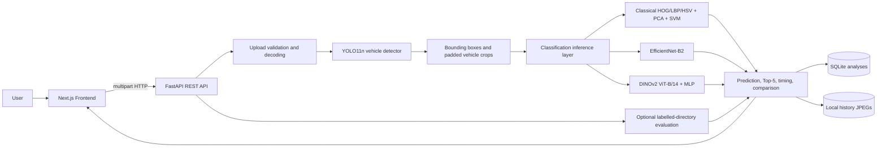
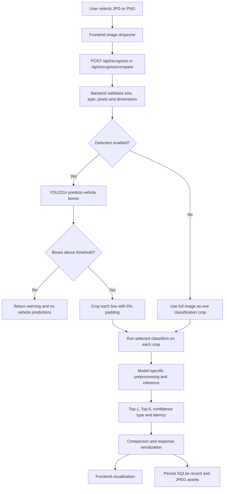
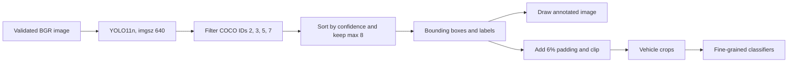
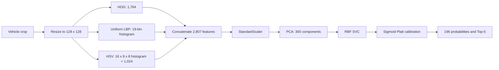
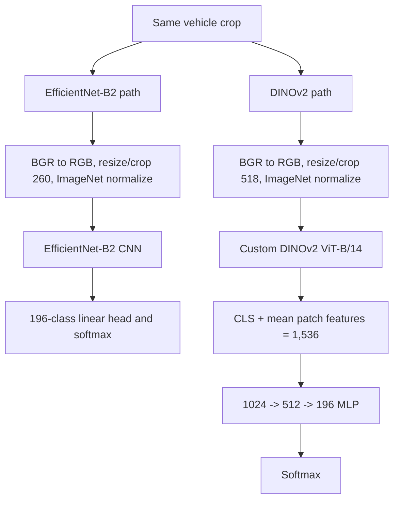
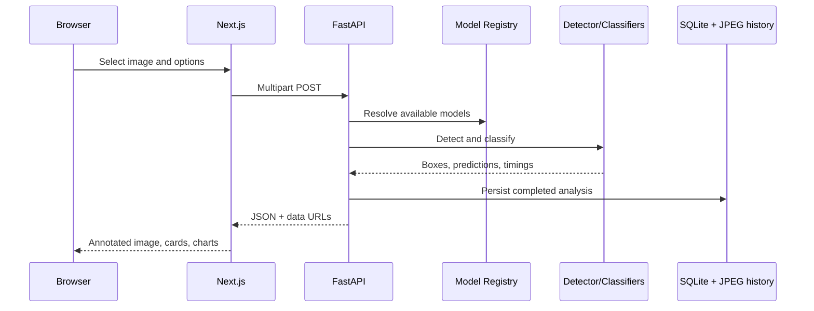
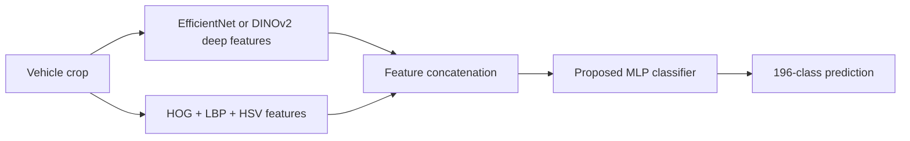

# Intelligent Fine-Grained Vehicle Recognition and Analysis System

## 1. Project Overview

AutoLens is a local full-stack computer-vision application for recognizing vehicles at
the fine-grained level of the Stanford Cars dataset. It combines general vehicle
localization with three independent 196-class classifiers:

1. A handcrafted-feature pipeline using HOG, LBP, HSV histograms, PCA, and an RBF SVM.
2. An EfficientNet-B2 transfer-learning checkpoint.
3. A custom DINOv2 ViT-B/14 checkpoint with an MLP classification head.

The application accepts JPG and PNG images, optionally detects one or more vehicles,
classifies each detected crop, returns Top-1 and Top-5 predictions, compares model
agreement, reports latency, and stores completed analyses locally.

### Problem statement and motivation

General vehicle detection answers *where* a vehicle is and what broad COCO category it
belongs to, such as `car`, `truck`, `bus`, or `motorcycle`. Fine-grained recognition
answers a more specific question: which make, model, body style, and year category best
matches the vehicle? These categories can differ by small visual details such as grille
shape, headlamps, wheel design, or model-year trim.

The project objectives are to:

- localize vehicles in arbitrary uploaded images;
- classify localized vehicles into the 196 Stanford Cars categories;
- compare an interpretable classical baseline with learned CNN and transformer
  representations;
- expose prediction confidence with its score type and provenance;
- provide a usable dashboard for recognition, comparison, performance, and history; and
- preserve experimental honesty by distinguishing recorded, reported, checkpoint
  metadata, and independently measured results.

### Dataset and scope

The target taxonomy is the Stanford Cars dataset with 196 fine-grained categories.
The supplied local validation set contains 120 labelled images from four classes:
AM General Hummer SUV 2000, Ford F-150 Regular Cab 2007, Honda Accord Sedan 2012,
and Hyundai Veloster Hatchback 2012. The official Stanford Cars test annotations
available to this project do not provide class labels, so a full labelled test-set
accuracy is not claimed.

The system performs image classification and optional object detection. It is not a
video tracker, an identity system, a license-plate reader, or a detector with measured
COCO/Stanford detection mAP.

### Technology stack

| Layer | Technologies |
| --- | --- |
| Frontend | Next.js 16.4.5, React 19, TypeScript, Tailwind CSS v4, shadcn/Base UI, Recharts, next-themes |
| API | FastAPI, Uvicorn, Pydantic v2, multipart uploads |
| Image processing | Pillow, OpenCV, NumPy |
| Classical ML | scikit-image, scikit-learn, joblib |
| Deep learning | PyTorch, Torchvision |
| Detection | Ultralytics YOLO11n, COCO vehicle classes |
| Persistence | SQLite metadata database and local JPEG files |
| Runtime | CPU by default; CUDA selected automatically when available |

## 2. Complete System Architecture



### Component responsibilities

- **Next.js frontend:** validates the client-side selection, sends `FormData`, selects
  models and detection threshold, renders annotated images, crops, confidence cards,
  comparison tables, charts, and history.
- **FastAPI application:** owns request validation, CORS, error responses, dependency
  injection, model startup, asynchronous request handling, and API serialization.
- **Upload layer:** accepts only JPEG/PNG content, verifies the image, normalizes EXIF
  orientation, enforces a 12 MB and 40-megapixel limit, and converts RGB input to
  OpenCV BGR.
- **YOLO11n detector:** restricts Ultralytics predictions to COCO IDs 2 (`car`), 3
  (`motorcycle`), 5 (`bus`), and 7 (`truck`). It returns at most eight detections.
- **Crop layer:** expands every detection by 6% in each dimension, clips it to image
  boundaries, and sends the same crop to every selected classifier.
- **Model registry:** loads all checkpoints once during FastAPI startup, chooses CPU or
  CUDA, tracks availability and load errors, and exposes model metadata and benchmarks.
- **Inference layer:** applies model-specific preprocessing, performs evaluation-mode
  inference, sorts five predictions, records model latency, and labels confidence type.
- **Analytics/evaluation:** builds model-agreement summaries and can calculate live Top-1
  and Top-5 accuracy from an optional class-directory dataset.
- **History layer:** stores analysis metadata and JSON results in SQLite and stores
  original, annotated, thumbnail, and crop images under `backend/data/history`.

The principal implementation modules are `backend/app/main.py`,
`backend/app/services/inference_service.py`, `backend/app/services/detection_service.py`,
`backend/app/models/registry.py`, and `frontend/lib/api.ts`.

### Relevant project structure

```text
backend/
  app/
    api/routes/       FastAPI route modules
    models/           Detector, classifiers, and registry
    services/         Feature extraction, preprocessing, inference, evaluation
    schemas/          Pydantic request/response models
    database/         SQLite schema and repository
    utils/            Image, checkpoint, and error utilities
  data/               SQLite database, reports, and history images
  scripts/            Offline calibration script
frontend/
  app/                Dashboard, recognition, comparison, performance, history, about
  components/        UI, upload, analysis, charts, and layout components
  hooks/              Backend/model/timing hooks
  lib/                API client, types, formatting, model metadata
```

## 3. End-to-End System Workflow



### Single-vehicle processing

If detection is enabled and one box is returned, the box is padded and treated as
vehicle 1. If detection is disabled, or the detector is unavailable, the full validated
image is treated as a single classification crop. The selected models run sequentially
on that crop and the response contains one `VehicleResult`.

### Multiple-vehicle processing

YOLO predictions are sorted by detection confidence and capped at eight. Each box gets a
stable one-based vehicle ID, a detector label/confidence, its own crop, and its own list
of model predictions. The backend builds comparison data independently for every vehicle.

## 4. Object Detection Architecture — YOLO

The detector is Ultralytics YOLO11n using the local `backend/yolo11n.pt` checkpoint when
present, with an Ultralytics asset fallback otherwise. It is a general object detector,
not a Stanford Cars fine-grained classifier. The implementation calls YOLO with
`imgsz=640`, the configured confidence threshold, and the four COCO vehicle class IDs.

The configured threshold defaults to `0.35` and is constrained to `0.05`–`0.95`.
`max_detections` is eight. Each result includes:

- detector class (`car`, `motorcycle`, `bus`, or `truck`);
- confidence in the detector's score space; and
- floating-point `x1`, `y1`, `x2`, `y2` coordinates.

The backend draws a labelled rectangle on an annotated copy of the input. It then
expands each box by `padding_ratio=0.06`, clips the coordinates to the image, and copies
the resulting crop. No additional duplicate-removal or custom non-maximum-suppression
logic is implemented in the application; Ultralytics supplies the detector results and
the application sorts and truncates them.



YOLO answers “is there a broad vehicle object here?” The SVM, EfficientNet-B2, and
DINOv2 answer “which Stanford Cars category is this crop?” A detector confidence and a
classification confidence therefore have different meanings and must not be compared
as if they were the same probability.

## 5. Approach 1: Handcrafted Feature Extraction with Classical Machine Learning



### Feature extraction

The crop is resized to 128×128 with OpenCV. HOG is computed on grayscale pixels with
nine orientation bins, 16×16 pixels per cell, 2×2 cells per block, and L2-Hys block
normalization. This produces 1,764 edge and gradient features.

Uniform LBP is computed on the same grayscale image with 16 sampling points and radius
2. Its normalized histogram uses 19 bins, producing 19 texture features.

The resized BGR image is converted to HSV. A normalized 3D histogram uses 16 hue bins,
8 saturation bins, and 8 value bins, producing 16×8×8 = 1,024 colour-distribution
features. The concatenated vector is therefore:

\[
  1764 + 19 + 1024 = 2807\text{ features}.
\]

### Scaling, PCA, and SVM

`StandardScaler` puts heterogeneous feature groups on comparable scales. PCA then
reduces 2,807 dimensions to 300 components; the project documentation records
approximately 72% retained variance. The reduced vector is classified by the original
RBF-kernel SVC (`C=1.0`, `gamma="scale"`) over 196 classes.

The supplied calibrated package preserves the SVM, scaler, PCA, feature parameters, and
canonical Stanford Cars class mapping. The application validates the expected dimensions
at load time.

Raw SVM decision scores are not probabilities. This build additionally stores a
`CalibratedClassifierCV` sigmoid (Platt) model fitted with five-fold cross-validation
on the Stanford Cars training split, excluding the 120-image validation set. Runtime
predictions use `predict_proba`, validate 196 finite values in `[0,1]` summing to one,
and label the result as `confidence_type="calibrated"`. They are calibrated estimates,
not correctness guarantees.

## 6. Approach 2: Deep Learning-Based Fine-Grained Vehicle Classification



### Model A — EfficientNet-B2

The backend reconstructs Torchvision `efficientnet_b2(weights=None)`, replaces its
classifier output layer with a 196-class linear layer, loads
`efficientnet_b2_transfer.pth`, moves it to the selected device, and enters evaluation
mode. The training metadata describes transfer learning followed by full-network
fine-tuning from ImageNet-initialized features; the supplied checkpoint's equivalence to
the reported fine-tuned run is not independently verified.

At inference, the OpenCV BGR crop is converted to RGB PIL. The actual configured
Torchvision transform uses bicubic `Resize(260)`, `CenterCrop(260)`, `ToTensor`, and
ImageNet normalization:

\[
\mu=(0.485,0.456,0.406),\quad
\sigma=(0.229,0.224,0.225).
\]

The code defines `EFFICIENTNET_RESIZE=292`, but the current transform does not use it;
therefore this document records the implemented 260-pixel resize/crop behavior rather than
claiming a 292-pixel shorter-side resize. The model applies softmax to logits and returns
the five highest classes.

### Model B — DINOv2 ViT-B/14

The checkpoint `dinov2_stanford_cars_finetuned_best.pth` contains separate
`backbone_state_dict` and `classifier_state_dict` entries plus class and training
metadata. The backend reconstructs a custom ViT-B/14-shaped backbone with:

- 14×14 convolutional patch embedding;
- 768-dimensional token embeddings;
- 12 transformer blocks;
- 12 attention heads;
- a learned class token and positional embedding for 1,370 patch positions plus the
  class token;
- LayerNorm, self-attention, GELU MLP, and LayerScale residual paths; and
- 518×518 input, yielding 1,369 patch tokens.

The backbone returns the normalized CLS token and the mean of patch tokens. Their
concatenation has 1,536 dimensions and feeds an MLP:

\[
1536 \rightarrow 1024 \rightarrow 512 \rightarrow 196.
\]

The head uses LayerNorm, ReLU, and dropout layers in its defined architecture. The loaded
model is placed in evaluation mode, so dropout is inactive during prediction. Its
softmax scores are returned as `confidence_type="softmax"`.

## 7. Comparison of Both Approaches

| Property | Classical SVM | EfficientNet-B2 | DINOv2 |
| --- | --- | --- | --- |
| Architecture | HOG/LBP/HSV → scaler → PCA → RBF SVC → calibration | Compound-scaled CNN + 196-class linear head | ViT-B/14-shaped backbone + 1,536-feature MLP |
| Learning method | Handcrafted features and supervised SVM | Transfer learning and full fine-tuning | Self-supervised foundation representation and fine-tuning |
| Feature extraction | 2,807 human-designed features | Learned convolutional features | CLS and mean patch-token representation |
| Input | 128×128 | Implemented 260×260 resize/crop | 518×518 |
| Score | Calibrated sigmoid estimate | Softmax probability | Softmax probability |
| Runtime device | CPU | CPU or CUDA | CPU or CUDA |
| Complexity | Low model footprint; feature extraction is CPU work | About 9.1M parameters in registry metadata | About 86.6M backbone parameters in registry metadata |
| Strength | Interpretable, lightweight baseline | Efficient learned visual hierarchy | High-resolution global and local representation |
| Limitation | Weak robustness to appearance and fine-grained variation | Supplied transfer checkpoint/run equivalence is unverified | High CPU latency and substantial memory/compute demand |
| Fine-grained behavior | Often confuses visually similar classes | Learns discriminative image features | Better captures detailed shape and context, but can still confuse near-identical trims |

The models behave differently because handcrafted descriptors encode fixed edges, local
texture, and colour statistics, while deep models learn task-dependent representations
from many layers of spatial context. Agreement is useful evidence but does not establish
correctness.

## 8. Evaluation Metrics

### Classification metrics

For \(N\) labelled images, Top-1 accuracy is:

\[
\mathrm{Top\text{-}1}=\frac{\#\{\text{images whose highest-scoring class is correct}\}}{N}.
\]

Top-5 accuracy counts an image as correct when its true class appears anywhere in its five
highest-scoring classes:

\[
\mathrm{Top\text{-}5}=\frac{\#\{\text{images whose true class is in Top-5}\}}{N}.
\]

For a class, with true positives \(TP\), false positives \(FP\), and false negatives
\(FN\):

\[
\mathrm{Precision}=\frac{TP}{TP+FP},\quad
\mathrm{Recall}=\frac{TP}{TP+FN},\quad
\mathrm{F1}=\frac{2PR}{P+R}.
\]

Here, precision asks whether predictions of “Honda Accord Sedan 2012” are correct;
recall asks whether the actual Honda Accord examples were found. F1 balances both.
**Support** is the number of ground-truth examples for a class. A confusion matrix
counts actual classes by predicted classes and exposes systematic confusions such as one
Hummer category being predicted as another.

**Macro average** is the unweighted mean of the per-class metric:

\[
\mathrm{MacroMetric}=\frac{1}{K}\sum_{k=1}^{K}\mathrm{Metric}_k.
\]

**Weighted average** weights each class by support:

\[
\mathrm{WeightedMetric}=\frac{\sum_{k=1}^{K} n_k\mathrm{Metric}_k}{\sum_{k=1}^{K}n_k}.
\]

Macro metrics treat rare and common classes equally; weighted metrics reflect the
observed class distribution. The recorded classical report's macro precision, recall,
and F1 are over the four classes present in its 120-image validation labels, while the
classifier still predicts among all 196 classes.

### Detection metrics

The application returns detector boxes and confidence but does not evaluate YOLO against
labelled detection ground truth. Consequently, IoU, detection precision/recall, AP, and
mAP are not measured project results.

For reference, IoU for predicted box \(B_p\) and ground-truth box \(B_g\) would be:

\[
\mathrm{IoU}=\frac{|B_p\cap B_g|}{|B_p\cup B_g|}.
\]

AP summarizes a precision-recall curve at a specified IoU threshold, and mAP averages
AP over classes and/or thresholds. Those quantities must not be inferred from the
classification scores shown by this application.

### Confidence and performance

- **YOLO confidence:** detector confidence for a broad COCO object.
- **Softmax score:** normalized score among the model's 196 logits; it can be
  overconfident and is not a calibrated correctness probability.
- **Calibrated SVM confidence:** sigmoid-calibrated estimate produced by the saved
  cross-validated calibration model.
- **Inference time:** model prediction time measured with a monotonic timer. The live
  benchmark uses a synthetic 640×480 image, up to five iterations, and reports the
  median per-model latency. It excludes browser/network time.
- **Total request time:** backend end-to-end analysis time, including detection and
  selected model calls.
- **Training time, memory, and model size:** training time and runtime memory are not
  comprehensively measured by the application. Checkpoint file byte sizes are exposed by
  `/api/models`, while registry parameter descriptions are metadata, not a memory
  measurement.

## 9. Existing Experimental Results

| Metric | Classical SVM | EfficientNet-B2 | DINOv2 |
| --- | ---: | ---: | ---: |
| Top-1 accuracy | 5.71% recorded original experiment | 60.04% reported fine-tuned run; checkpoint equivalence unverified | 93.33% measured on 120 local labelled images / 4 classes |
| Top-5 accuracy | 17.00% recorded original experiment | 83.18% reported fine-tuned run; checkpoint equivalence unverified | 98.33% measured on the same local set |
| Macro precision | 6.48% recorded metadata | Not supplied | Not supplied |
| Macro recall | 5.52% recorded metadata | Not supplied | Not supplied |
| Macro F1 | 5.01% recorded metadata | Not supplied | Not supplied |
| Mean local validation latency | 2,329.74 ms/image, 120 images | Not supplied in the recorded evaluation | 2,795.1 ms/image, 120 images |
| Provenance | Recorded, plus separate calibration report | Reported, not independently verified | Measured locally on four classes |

The separate classical calibration report measured 20.00% Top-1 and 32.50% Top-5 on
the same 120-image four-class set, with macro precision 48.00%, macro recall 15.18%,
and macro F1 19.25%. These figures should not be confused with the older 5.71%/17.00%
recorded experiment shown in model metadata.

Its calibration diagnostics were ECE 16.77%, multiclass Brier score 0.974773, negative
log-likelihood 4.440047, and mean Top-1 confidence 3.23%. All 120 predictions produced
finite 196-class probabilities in `[0,1]` summing to one.

DINOv2's measured errors include Hummer SUV versus Hummer H2 SUT, and Ford F-150
2007 versus nearby Ford/GMC categories. This illustrates that even strong results remain
vulnerable to visually similar model-year variants. The checkpoint metadata also reports
94.35% on its original validation split, but that split is not supplied and the value is
therefore labelled checkpoint metadata rather than an independently reproduced result.

## 10. Application Architecture

### Frontend

The Next.js App Router exposes:

1. **Overview** (`/`): health, model readiness, analysis counts, and recent activity.
2. **Vehicle Recognition** (`/recognition`): upload, model selection, detector toggle,
   threshold control, and one analysis.
3. **Model Comparison** (`/comparison`): runs all three classifiers on the same crop and
   displays agreement and disagreement.
4. **Model Performance** (`/performance`): accuracy provenance cards, charts, and live
   latency benchmark.
5. **Detection History** (`/history`): paginated saved analyses, model filtering,
   detail inspection, deletion, and clear-history actions.
6. **About Project** (`/about`): system anatomy, endpoint catalogue, model information,
   and limitations/roadmap messaging.

The interface uses responsive Tailwind layouts, reusable Base UI/shadcn components,
Recharts, Lucide icons, and light/dark theme support through `next-themes`.

### Backend and API

FastAPI initializes settings, SQLite, the model registry, and the detector in its
lifespan handler. CORS allows the local frontend origins and GZip is enabled for larger
responses. Structured errors use `{success:false,error:{code,message}}`.

| Method | Route | Request / response purpose |
| --- | --- | --- |
| GET | `/api/health` | Runtime, database, device, model, detector, and evaluation health |
| GET | `/api/models` | All model metadata, availability, metrics, checkpoint sizes, and provenance |
| GET | `/api/models/{model_id}` | One model's metadata |
| GET | `/api/models/benchmark` | Median live model latency on a synthetic image |
| POST | `/api/detect` | Multipart `file` and `confidence`; returns boxes, annotated image, and crops |
| POST | `/api/recognize` | Multipart `file`, `models`, `use_detection`, `detection_confidence`; returns full analysis |
| POST | `/api/recognize/compare` | Same as recognition but always selects all classifiers |
| GET | `/api/comparison` | Model metadata for comparison UI |
| GET | `/api/history` | Paginated history, optionally filtered by model |
| GET | `/api/history/stats` | History aggregates |
| GET | `/api/history/{id}` | Full saved analysis |
| GET | `/api/history/{id}/image` | Stored original, annotated, thumbnail, or crop JPEG |
| DELETE | `/api/history/{id}` | Delete one analysis and associated assets |
| DELETE | `/api/history` | Clear all history and assets |
| POST | `/api/evaluate` | Optional live Top-1/Top-5 evaluation from `EVAL_DATASET_DIR` |



## 11. Model Inference and Prediction Pipeline

At startup, `ModelRegistry.load_all()` loads class names and all three classifier
checkpoints. Missing or incompatible files mark an individual model unavailable with an
explicit error; the application can continue with the remaining available models.
`DEVICE=auto` chooses CUDA when available and otherwise CPU. The classical model always
runs on CPU.

Each model enters evaluation mode. PyTorch models use `torch.inference_mode()`. A
threading lock surrounds each model and the detector, protecting shared model instances
during concurrent requests. Each prediction returns:

- model ID/name and approach;
- predicted class and canonical class ID;
- Top-5 entries sorted descending by score;
- confidence and `confidence_type`;
- per-model inference time; and
- an explanatory note where needed.

The backend sends one identical detector crop to each selected classifier. The crop is
then resized and normalized independently according to the model's pipeline. The frontend
does not recompute predictions; it renders the typed response.

## 12. Data and Persistence Design

SQLite contains one `analyses` row per persisted result. The row stores the input
filename, model IDs, detection state/count, primary prediction, confidence metadata,
inference time, filenames for image assets, crop metadata JSON, and complete result JSON.
An index supports descending creation-time history queries.

The associated local files include:

- `<id>_original.jpg`;
- `<id>_thumbnail.jpg`;
- `<id>_annotated.jpg`, when detection produced boxes; and
- `<id>_vehicle_<n>.jpg` for each processed vehicle.

History is local to the configured backend data directory. The UI provides individual
and complete deletion, and the repository removes associated files when records are
deleted.

## 13. Limitations and Challenges

- **Fine-grained similarity:** nearby model years, trims, and related vehicles can share
  nearly identical visual features.
- **Handcrafted features:** fixed edge, texture, and colour descriptors do not learn
  semantic invariances and the recorded classical results are weak.
- **Dataset coverage:** the local measured set covers only four of 196 classes, so it
  cannot establish full-taxonomy generalization.
- **Detection dependence:** missed or incorrect YOLO boxes produce poor crops; a
  detector confidence threshold is not a classification threshold.
- **Calibration:** only the classical SVM has sigmoid calibration. Softmax scores from
  the deep models are not guaranteed to be calibrated.
- **Latency:** CPU inference is slow, especially for the high-resolution DINOv2 path;
  the live benchmark excludes network and browser time.
- **Compatibility:** checkpoints must match their reconstructed architecture and the
  canonical 196-class ordering. The EfficientNet checkpoint's claimed fine-tuned
  validation results are not independently tied to the supplied file.
- **Detection evaluation:** no labelled detection benchmark is included, so detector
  precision, recall, IoU, AP, and mAP are unavailable.
- **Operational scope:** the application is a local image analysis tool, not a
  production multi-tenant service or continuous video pipeline.

## 14. Future Scope — Approach 3 (Planned, Not Implemented)

The following hybrid approach is a roadmap item only:



The motivation is to combine learned semantic and shape representations with explicit
edge, texture, and colour signals. A future experiment could standardize the handcrafted
vector, select a documented deep embedding layer, concatenate the vectors, train an MLP,
and compare accuracy, calibration, latency, and ablations against the current models.
The current application contains no hybrid fusion, ensemble weighting, retrieval index,
or Approach 3 endpoint.

## 15. Conclusion

This system integrates a YOLO11n detector with three fine-grained Stanford Cars
classifiers behind a FastAPI service and a Next.js dashboard. It supports both
classification-only and multi-vehicle detection workflows, applies model-specific
preprocessing to the same vehicle crop, exposes Top-1/Top-5 predictions and score types,
compares model agreement, reports live latency, and stores local analysis history.

The classical SVM provides an interpretable baseline but has poor recorded accuracy.
EfficientNet-B2 supplies a compact learned CNN path whose reported metrics remain
unverified for the supplied transfer checkpoint. DINOv2 is the strongest independently
measured path on the limited four-class local validation set, while still showing
near-neighbour confusions and high CPU cost. The next major research direction is a
carefully evaluated hybrid feature-fusion model, explicitly kept separate from the
implemented system until it exists and is measured.

## 16. Source and Evidence Index

| Concern | Implementation or evidence |
| --- | --- |
| Application lifecycle and routes | `backend/app/main.py` |
| Settings and checkpoint paths | `backend/app/config.py` |
| Detection and crop orchestration | `backend/app/models/detector.py`, `backend/app/services/detection_service.py`, `backend/app/utils/image_utils.py` |
| End-to-end recognition | `backend/app/services/inference_service.py` |
| Classical pipeline | `backend/app/models/classical_model.py`, `backend/app/services/feature_extraction.py` |
| EfficientNet pipeline | `backend/app/models/efficientnet_model.py`, `backend/app/services/preprocessing.py` |
| DINOv2 reconstruction | `backend/app/models/dinov2_model.py` |
| Model metadata, provenance, benchmark | `backend/app/models/registry.py` |
| API schemas | `backend/app/schemas/response.py` |
| Optional evaluation | `backend/app/services/evaluation_service.py` |
| SQLite persistence | `backend/app/database/models.py`, `backend/app/database/repository.py` |
| Frontend API contract | `frontend/lib/api.ts`, `frontend/lib/types.ts` |
| Frontend pages/navigation | `frontend/app/*/page.tsx`, `frontend/lib/navigation.ts` |
| Classical calibration evidence | `backend/data/classical_svm_calibration_eval.json` |
| DINOv2 local evaluation evidence | `backend/data/dinov2_hf_eval.json` |
| Project-level provenance notes | `README.md` |
